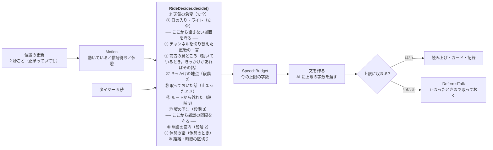

# CycleGuide の設計

| 項目 | 内容 |
|---|---|
| 対象 | CycleGuide（yorisoi-cycleguide）の構造と、platform・管理システムの変更 |
| 読む人 | アプリ開発者 |
| 状態 | 設計（承認済み。段階 1 は実装済み） |
| 関連 | [要件定義](requirements.md)、[platform ADR-ECOSYSTEM-PLATFORM](https://github.com/duwenji/yorisoi-platform/blob/main/docs/decisions/ADR-ECOSYSTEM-PLATFORM.md)、[SanpoGuide の構造図](https://github.com/duwenji/yorisoi-sanpoguide/blob/main/docs/architecture.md) |

SanpoGuide と同じ作りを基本にします。DI ライブラリは使わず、`CycleApp.onCreate()` が共有部品を作り、画面と常駐のサービス（`RideService`）がそれを使います。散歩と違うのは、主に次の 4 つです。

1. **走り方**（`RideStyle`）が判定の値をまとめて持つ（要件 D-5）
2. **動いているかどうか**（`Motion`）で、話すかどうかと話の長さを変える（D-6）
3. **前方**を探し、着く前に話し終える（F-2）
4. **走行中は画面と操作を出さない**（S-1・S-2）

## 図 1 · 全体

```mermaid
flowchart LR
  subgraph UI["画面（ui）"]
    MainActivity
    MainScreen["MainScreen<br/>最後の話・地図（走行中は止まっているときだけ。走行の外は前回の走行）"]
    RidingScreen["RidingScreen<br/>「走行中」だけ"]
    SettingsScreen["SettingsScreen<br/>走り方・値の調整・AI"]
    HistoryScreen["HistoryScreen<br/>履歴・振り返り（段階 2）"]
  end

  subgraph RIDE["常駐処理（ride）"]
    RideService["RideService<br/>位置・判定・読み上げ・通知"]
    EarphoneNotice["EarphoneWatch・EarphoneRule<br/>イヤホンの注意"]
    MediaButtons["MediaButtons<br/>止める・もう一度（段階 3）"]
  end

  subgraph APP["共有部品（CycleApp.onCreate() で生成）"]
    style["style<br/>RideStyle・RideStyles・StyleValues"]
    companion["companion<br/>Motion・Ahead・QuietZones・SpeechBudget<br/>RideDecider・RideSession・DeferredTalk"]
    channel["kit-channel（platform に新設）<br/>Station・StationPrompts・StationRepository"]
    guide["kit-llm<br/>LlmClient・RelayClient・OperatorAi・OutputCheck・AiUsage"]
    geo["kit-geo<br/>SpotRepository・Overpass・天気・日の入り・地図<br/>前方の探し方・信号・自転車のルート"]
    voice["kit-voice<br/>Speaker"]
    history["history<br/>RideHistory（段階 2）"]
    diag["diagnostics<br/>開発者モードの記録"]
  end

  MainActivity --> RideService
  MainActivity -- "Motion を見て切り替える" --> MainScreen & RidingScreen
  RideService --> companion --> style
  companion --> geo & channel
  RideService --> guide & voice & history & diag
  RideService --> EarphoneNotice & MediaButtons
```

`RideService` が中心です。位置が来るたびと一定の間隔で `maybeTalk()` を呼び、そのときの状況（`RideSituation`）を集めて `RideDecider` に渡します。`RideDecider` は platform の `kit-companion` の `TalkEngine` に、ルールの並びを渡すだけです（ADR-ECOSYSTEM-PLATFORM E-7）。

## 図 2 · 走行中の判定



ゲート（`RideGate`）は 4 つです。

| ゲート | 開いている条件 | かかるルール |
|---|---|---|
| `NOT_QUIET` | 止まっている。または、動いていて、信号から 30 m より離れ、走り方の「話さない速さ」より遅い（F-5） | ③〜⑩ |
| `SPOT_GAP` | 前の見どころの話から、走り方の間隔 × チャンネルの頻度の倍率が過ぎた | ④・④′ |
| `CHAT_GAP` | 前の話から、雑談の間隔が過ぎた | ⑧〜⑩ |
| `NOT_SWITCHED` | チャンネルを切り替えてから 1 分が過ぎた | ④〜⑩ |

①② は安全のルール（`safety = true`）で、どのゲートもかけません（S-4）。

## 主な部品の設計

### 走り方（`style`）

- 走り方（`RideStyle`）は、名前・見どころの選び方（`SpotScale`：小さな見どころも／大きな見どころだけ）・案内する施設（`Amenity`）と、判定の値（`StyleItem` ごとの既定値）を持ちます。値の一覧と範囲は `StyleItem` にあり、要件の「走り方のプリセット」の表の項目に、ひと言の間隔・距離の区切り・天気の予告の間隔・強い雨・日の入りを知らせる最後の時刻を足したものです

- `RideStyles.ALL` にプリセットを並べます。画面と判定はこの一覧だけを読むので、1 件足せばそのまま使えます（F-12・AC-15）
- アプリ利用者の調整は、SanpoGuide の `Thresholds` と同じ形（項目 → 値、範囲で丸める）の `StyleValues` で、走り方ごとに保存します。話せなくなる組み合わせ（日の入りの時刻の逆転、休憩が信号待ちより短い）は `conflicts()` で設定の画面に出します
- チャンネルの頻度（`talkLevel`：控えめ・ふつう・おしゃべり）は、間隔に掛ける倍率にします（×2・×1・×0.5）。頻度はエコシステムの語彙のまま、値はアプリが持ちます

### 動いているかどうか（`Motion`）

| 状態 | 条件 |
|---|---|
| `MOVING` | 直近の速度（3 点の中央値）が 0.8 m/s 以上。押して歩く速さ（5 km/h ≒ 1.4 m/s）は動いているに入る |
| `SIGNAL_STOP` | 止まっている（下の「止まっている」）のが、走り方の「信号待ちとみなす長さ」（`SIGNAL_STOP_SEC`）以上続いた |
| `REST` | 止まっているのが、走り方の「休憩とみなす長さ」（`REST_MIN`）以上続いた |

- 止まっている: 速度が 0.8 m/s 未満。止まったあとは、速度が 0.8 m/s 以上になっても、最後に遅かった場所から 10 m（位置の精度のほうが大きければ精度）離れるまでは止まっているとします。止まっていても GPS の速度は 1.3 m/s ほどまで揺れることがあり、位置はほとんど動きません（実機の記録）
- 位置が 10 秒より長く来ない間（トンネルなど）は、状態を変えません。止まった長さも数えません。そのあとの止まった長さは、次に来た位置から数えます（AC-26）
- 精度の悪い位置（50 m より悪い）の速度は使いません（SanpoGuide と同じ）。ただし位置は来ているので、上の「来ない間」には入れません（屋根の下で休んでいる間に、止まった長さを数え直さない）
- 走った距離には、精度の悪い位置と、前の位置から 3 m（位置の精度のほうが大きければ精度）より近い位置を足しません

### 話の長さ（`SpeechBudget`）

- 上限の字数 = 走り方の秒数 × 1 秒あたりの字数（5 字）。1 秒あたりの字数は、開発者モードの記録（話した文の字数と、読み上げにかかった時間）で測ったもの。エミュレータで約 5 字だった
- 上限の字数は、プロンプトのスロット（`{{max_chars}}`）で AI に渡します
- 返事が上限を超えたら、読まずに `DeferredTalk` として取っておきます。取っておいた話は、次に止まったときに、そのときの上限に収まれば話します（信号待ちで収まらなければ、休憩まで待ちます）。見どころから 500 m 離れたもの、10 分たったものは捨てます（`DeferredTalk.prune`）

### 前方（`Ahead`）

- 進む向きは、`Location.bearing`（速度が 1 m/s 以上のとき）と、直近 30 m の移動の向きから決めます
- 前方の範囲は、向きの左右 45° の扇形で、走り方の「前方を探す距離」（`AHEAD_M`）までです
- 残りの時間 =（距離 − 50 m）÷ 速度 − 話の秒数 − 文を作る時間（5 秒）。残りの時間が 15 秒以下になったら話し始め、0 を切っていたら間に合わないので取っておきます（`Ahead.timing`。`RideDecision.Defer`）
- スポットの取得は、現在地ではなく前方の点（現在地から向きに「前方を探す距離」の半分進んだ点）を中心に行います（kit-geo の `SpotRepository` の `searchCenter`）。中心が 300 m 動いたら取り直します

### 話さない場面（`QuietZones`）

- 信号の位置（OSM の `highway=traffic_signals`）を、スポットと一緒に Overpass で取ります
- 動いているときに、信号から 30 m 以内に入るか、走り方の「話さない速さ」以上になったら、`NOT_QUIET` を閉じます。止まっているとき（信号待ちを含む）は閉じません

### 画面と通知（S-1・S-2・S-3）

- `MainActivity` は `Motion` を見て、`MOVING` のときは `RidingScreen`（「走行中」とだけ出す暗い画面）にします。`FLAG_KEEP_SCREEN_ON` は付けません
- 常駐の通知は、`MOVING` の間は操作のボタンを外した形に差し替えます
- 地図（`RideMap`。kit-geo の `SpotMap`、地理院 淡色）は、走行中に止まっているときだけメインの画面に出します。現在地と向き・見つかった見どころ・今回走った道（`RideSession.route`）
- 走行の外では位置を使わないので、現在地の地図は出しません。代わりに前回の走行（`LastRideMap`）を出します。始めた日時・距離・時間と、走った道の全体（`SpotMap` の `fitWalked`）・話した見どころ（`RideSession.spots`）です。履歴（`RideHistory`）のいちばん新しい走行です。道は 1000 点まで間引き、見どころは地図が描くのに要る値（ID・名前・緯度経度・種類）だけです。動かずに終えた走行（道が 2 点未満）は残さず、前の走行がそのまま出ます。設定の「履歴を消す」で消します
- `EarphoneWatch` は `AudioDeviceCallback` でイヤホン（Bluetooth・有線・USB）を見つけます。つながっていれば、止まっているときに走行ごとに一度、注意を読み上げます（`EarphoneRule`）。初めて走り始める前の注意は、開始の画面のダイアログで出します

### 段階 2 の部品

| 部品 | 設計 |
|---|---|
| 走行の履歴（F-28） | `history` の `RideHistory` が、走り終えた走行を `files/rides/` に新しい順で残します（端末の中だけ、P-1）。一覧（`index.json`。始めた日時・終えた日時・距離・話した見どころの数・振り返り）と、1 件ごとのファイル（`<始めた日時>.json`）に分け、一覧をすぐ読めるようにします。1 件（`RideRecord`）は、始めた日時・終えた日時・距離・走った道・話した見どころ・見どころごとの話（`SpotTalk`：見どころの ID・名前・話した時刻・話の文）・使ったチャンネルの並び・振り返りです。残すのは 500 件まで（SanpoGuide の `HistoryStore` と同じ）。開始の画面の前回の走行（F-31）は履歴のいちばん新しい走行です。段階 1 の `files/last-ride.json` は、履歴が空のときに 1 件目として取り込んで消します。設定の「履歴を消す」ですべて消します |
| 振り返り（F-28） | 走行を終えると、AI に振り返りを作らせて読み上げます（プロンプトは `companion/events/finish`。材料は距離・時間・話した見どころの名前）。止まっているので、長さの上限は休憩と同じです。位置の受け取りを止めてから作り、文は履歴に残し、`HistoryScreen` の 1 件の画面で地図と一緒に出します。AI が 15 秒のうちに答えないときは、距離だけの定型の文にします。終了のボタンを押さずにサービスが止められたときは、振り返りなしで残します |
| 履歴の画面（F-20・F-28） | `HistoryScreen` は一覧（日時・距離・時間）と 1 件の画面（`SpotMap` の `fitWalked` で走った道と話した見どころ、振り返り、見どころごとの話）です。走行中は開けません（S-2） |
| 施設の案内（F-7） | kit-geo の `FacilityKind` に、駐輪場（`amenity=bicycle_parking`）・コンビニ（`shop=convenience`）・自転車店（`shop=bicycle`）・空気入れ（`amenity=bicycle_repair_station` で `service:bicycle:pump=yes` のもの、`amenity=compressed_air`）を足し、取る種類を `SpotRepository` に渡せるようにします（渡さなければ今と同じ。SanpoGuide は変えない）。`Amenity` は `FacilityKind` の組み合わせに対応させます（トイレ＝トイレ、水分＝水飲み場・自動販売機、ひと休み＝休憩所・ベンチ）。取るのはどの走り方の種類も合わせたもの（`Amenity.SEARCHED`）で、走り方を変えても取り直しません。話すのと、止まっているときの地図に出すのは、走り方の種類だけです（AC-14） |
| 施設の判定（F-7） | `AmenityAdvisor`（Android に依存しない）が、前方（`Ahead` の扇形、`AHEAD_M` まで）の施設から、いま話すものを 1 つ選びます。ルール ⑧ で、`CHAT_GAP`・`NOT_QUIET`・`NOT_SWITCHED` をかけます。前方の施設は 50 m より先で、近いものから選びます。種類ごとの条件は、トイレ・ひと休み・補給が走り始めてから、または前に同じ種類を話してから「トイレ・ひと休み・補給を知らせる間隔」（`AMENITY_GAP_MIN`。ポタリング 45 分・ロングライド 60 分）、水分が気温 25℃ 以上、駐輪場が休憩のとき（向きを問わず 300 m 以内）、自転車店・空気入れが走行ごとに一度です。同じ施設は走行ごとに一度だけです。文は定型（「200メートル先に、トイレがあります。」。距離は 50 m 単位、名前があれば添える）です。SanpoGuide の `FacilityAdvisor` は歩く人の近さで選ぶので、条件が違います。共通にするのは方角の言い方（kit-geo の `relativeDirection`）だけです |
| チャンネルの取り込み（F-26） | platform に移した `kit-channel` の `ThirdPartyChannels`（`ChannelSync`・`ChannelStore`）を使います。アプリの見え方は `CycleProfile`（`AppIds.CYCLEGUIDE`・`Activity.CYCLE`・使える機能は管理システムの `ecosystem.ts` と同じ `slot:guide`・`slot:companion`・`trigger:spot`・`trigger:point`・`present:speak`）で渡します。リストは起動時と走行の開始時に、1 日たっていれば確かめます。`activities` に `cycle` を含まないチャンネルは、互換性の確かめで外れます（AC-9）。素材集は、見どころの AI の依頼の根拠に使います（`Narrator`）。`kit-channel` の `Grounding` が、チャンネルが使う素材集のうち AI の根拠に使ってよいもの（`grants.grounding`）から、そのスポットについての資料を最大 3 つ・1,500 字まで集め、`guide/user` の `<資料 出典="…">` に入れます（山かっこは全角に）。資料を使った話の出典には「〇〇の資料をもとに作成」を足します。素材集はきっかけで使うものしか宣言できない（API-CHANNEL-PACKAGE）ので、資料が届くのは、きっかけ（F-32）を持つチャンネルです |
| きっかけ（F-32） | `kit-channel` の `CueFinder`（当たりの判定と `repeat` の回数。回数は `files/cues.json`）と `CuePresenter` を使います。`CuePresenter` には出す見せ方を `{speak}` だけ渡し、ほかの見せ方の素材は作りません（X-7。カードに AI の解説を指していても AI を呼ばない）。読み上げに使うのは、最初の読み上げの見せ方の、最初の文字の素材です。組み込みの素材提供者は `builtin:ai-guide`（`Narrator.spot`。依頼の `grounding` をそのまま資料にする）と `builtin:fallback-text`（定型の見どころの文）だけで、ほかの組み込み（写真・背景音・雰囲気の絵・話しかけ）は持たないので、候補の次に進みます。走行の様子（`RideSituation`。走っているか・いまの上限の字数）は `Situation` で渡し、`builtin:ai-guide` はその字数で頼みます |
| スポットのきっかけ（F-32・ルール ④） | `RideService` が前方の見どころごとに、名前・OSM の ID で指すきっかけがあるかを見て `AheadSpot.cued` に入れます。ルール ④ は、きっかけで指された見どころを、走り方の見どころの大きさ（`spotScale`）と飛ばす種類にかけずに選び、同じ距離なら先に選びます（種類で指すきっかけ `anySpot` は選び方を変えない）。話すときに `CueFinder.spot` が当たれば、そのきっかけの読み上げを話し、当たらない（回数を使い切った）か素材がなければ、今までどおり `Narrator.spot` です。文が走行中の上限を超えたら、今の見どころと同じく `DeferredTalk` に取っておきます。間に合わずに取っておいた見どころも、止まったときにきっかけの文を話します。回数は、きっかけの文を作ったときに数えます（その走行では試し直さない） |
| 地点のきっかけ（F-32・ルール ④′） | `RideService` が位置の更新ごとに `CueFinder.point` で、いる地点のきっかけを探し、`RideSituation.pointCue` に入れます。ルール ④′ は `NOT_QUIET`・`SPOT_GAP`・`NOT_SWITCHED` をかけ、走っていても止まっていても話します（ルール ④ のあと）。上限を超える文は `DeferredTalk` に取っておきます。`DeferredTalk` は見どころ（`Poi`）の代わりに、名前と位置を持つ形にします（地点のきっかけの名前はチャンネルの名前）。`builtin:ai-guide` が話すのは、地点の中の見どころのうち、その走行でまだ話していないもので、情報の多いもの（`Poi.notability`）、同じなら地点の中心に近いものです。ない場合は話しません。地点の話は、履歴の「話した見どころ」に入れません |
| チャンネルの画面（F-20・F-26） | 設定の「チャンネル」で、組み込みと取り込んだチャンネルから選びます（走行中は変えられません）。`ChannelsScreen`（リストの追加・チャンネルの取り込みと削除・通報）は SanpoGuide の画面を元に、このアプリで書きます（画面はアプリに置く、E-4）。走行の外で、開発者モードのときだけ開けます（SanpoGuide と同じ。エコシステムのリストが公開されるまで）。取り込んだチャンネルは、話す量を見せて利用者が「使う」を選んでから使います（platform ADR-AI-ROLES H-9）。試用チケットはまだ読めません |
| プロンプト・パックの公開（F-30） | `:prompts` を GitHub Packages に公開します（`io.github.duwenji.yorisoi.cycleguide:prompts`、版は `cycleguidePromptsVersion`）。審査の見本（`ReviewSamples`）を足し、`cycle` のチャンネルを、このアプリが送るのと同じプロンプトで組み立てます |
| 審査の見本（X-6） | yorisoi-console の validator が、SanpoGuide のパックと CycleGuide のパックの両方を使い、チャンネルの `activities` で選びます（`walk` は SanpoGuide、`cycle` は CycleGuide。両方を含むときは両方の見本）。どちらも含まないときだけ `noRepresentativeApp` を返します（AC-23） |

### 段階 3 の部品

| 部品 | 設計 |
|---|---|
| 自転車のルート（F-15） | kit-geo の `RouteClient` に自転車のプロファイル（FOSSGIS OSRM の自転車）を足す |
| ルートに沿った取得（F-16） | ルートを 1 km ごとに区切り、Overpass の `around`（線に沿った範囲）で前もって取る |
| ルートから外れた（F-17） | ルートの線からの距離が 50 m を超える状態が 10 秒続いたら、一度だけ話す |
| 坂の予告（F-8） | 標高の取り先は U-2 で決める（候補: Open-Meteo の Elevation API。天気と同じサービス） |
| メディアボタン（F-21） | `RideService` に `MediaSession` を持たせ、再生・一時停止で「止める」「もう一度」を切り替える |

## モジュールとパッケージ

| モジュール | 中身 |
|---|---|
| `:app` | 画面・常駐・判定・走り方・記録 |
| `:prompts`（JVM） | CycleGuide のプロンプト・パック（`io.github.duwenji.yorisoi.cycleguide:prompts`）。プロンプトの枠、組み込みのチャンネル、審査の見本（F-30） |

`:app` のパッケージ（`io.github.duwenji.yorisoi.cycleguide.`）:

| パッケージ | 役割 | 主なファイル |
|---|---|---|
| `ui` | 画面と ViewModel | MainScreen, RidingScreen, SettingsScreen, HistoryScreen |
| `ride` | 常駐のサービス、イヤホンの注意、メディアボタン、前回の走行 | RideService, EarphoneWatch, EarphoneRule, MediaButtons, LastRide |
| `companion` | 判定とその材料、定型の話（AI で文を作るまでの話と、安全の案内の文） | RideDecider, RideSession, Motion, Ahead, QuietZones, SpeechBudget, DeferredTalk, Lines |
| `style` | 走り方と調整 | RideStyle, RideStyles, StyleValues |
| `settings` | 設定の保存（走り方・走り方ごとの値の変更・チャンネル・イヤホンの注意を出したか） | SettingsRepository |
| `history` | 走行の履歴（段階 2） | RideHistory |
| `diagnostics` | 開発者モードの記録の書き出し（記録そのものは platform kit-companion の `SessionRecorder`。走行の開始・位置・状態・判定・話・読み上げの時間・AI・天気・スポットの検索） | RideExport |
| (root) | 共有部品の生成、通知チャンネルの登録 | CycleApp |

## platform に移すもの（要件 D-4）

SanpoGuide のアプリ側にあるコードを、CycleGuide で使う段階の前に platform に移します。移したあと SanpoGuide もそれを使うように直し、SanpoGuide のテストとエミュレータの散策で確かめます（R-3）。

| 段階 | 移すもの（SanpoGuide のいまの場所） | 移す先 | 直す抽象 |
|---|---|---|---|
| 1 | `guide/OperatorAi`・`guide/OutputCheck`・`settings/AiUsage` | `kit-llm` | `OperatorAi` が読む `BuildConfig`（中継の URL・Play Integrity）を引数にする |
| 1 | `station/Station`・`StationRepository`、`material/ChannelMaterials`、`:prompts` の `BuiltInChannels` の読み込み | `kit-channel`（新設。`Station`・`StationRepository`・`ResourceChannels`・`ChannelMaterials`） | `Station` が持つ頻度を、コアの段階（`TalkLevel`）だけにする。間隔などの値はアプリが持つ。`StationRepository` は設定（`GuideSettings`）ではなく `ChannelChoice` を受け取り、記録（`WalkRecord`）ではなくチャンネルの key の並びから名前を作る。スロットからプロンプトの変数を作るところ（`StationPrompts`）、表示名（`StationLabels`）、費用の目安（`AiCost`）は、アプリの文面と値によるのでアプリに残す |
| 1 | `diagnostics/WalkDiagnostics` | `kit-companion`（`SessionRecorder`） | 散歩の名前を外し、開始と終了の種類の名前を引数にする（SanpoGuide は `walk_start`・`walk_end` のまま） |
| 2 | `station/remote`（`ChannelSync`・`ChannelStore`・`ThirdPartyChannels`・`TinkEd25519`）、`report/Report` | `kit-channel` | `ChannelSync` が読む `SanpoProfile` を `AppProfile` の引数にする |
| 2 | `material`（`Producer`・`Cues`・`Selectors`・`MaterialPlan`・`Grounding`・`ResourceProducer`） | `kit-channel` | `Producer` が読む `TalkEvent`・`WalkSession` を、汎用の文脈（`MaterialContext`、ADR-ECOSYSTEM-PLATFORM E-16）にする |

`kit-channel` の新設は、E-4（「素材提供者の実装とチャンネルの取り込み・画面は、2 本目のアプリで共通の形が分かるまでアプリに置く」）の見直しにあたります。段階 1 の移し替えの前に、platform の ADR に足します。

## platform・管理システムのそのほかの変更

| 段階 | 先 | 変更 |
|---|---|---|
| 1 | kit-geo | 天気の急変の判定（`WeatherChangeDetector`。SanpoGuide から移し、先読みの時間と強い雨の量を引数にする） |
| 1 | kit-geo | 前方を中心にした取得（`SpotRepository` に取得の中心を渡せるようにする。渡さなければ今と同じ）、信号の位置の取得（任意。SanpoGuide は使わない） |
| 1 | core-format | `cycleguide` を含む版を公開する（PR #29 は版を上げていない） |
| 1 | yorisoi-console | アプリの一覧（`ecosystem.ts`）・中継の受け付けるパッケージ（`relay-config.ts`）・段階の版（`appStageVersions`）に CycleGuide を足す（要件 X-5） |
| 2 | yorisoi-console | `cycle` の見本を、CycleGuide のプロンプト・パックで作る（X-6） |
| 2 | kit-channel | `CuePresenter` に出す見せ方の集まりを渡せるようにする（渡さなければ今と同じ。SanpoGuide は変えない）（X-7） |
| 2 | yorisoi-console | `ecosystem.ts` の cycleguide の機能に `trigger:spot`・`trigger:point` を足す。素材を持つチャンネルは第 1 段なので、段階の版（`appStageVersions`）の cycleguide の第 1 段を 1.4.0 (7) からにする（開発用。本番は Play に出すとき）。通しの確認の台本（`tools/e2e/app-check.ts --cycle`）を、地点のきっかけ付きにする（X-7） |
| 3 | kit-geo | 自転車のルート、線に沿った取得、標高 |

## 段階 1 の実装の順番

1. platform: ADR に `kit-channel` を足す。kit-llm・kit-channel への移し替え、kit-geo の前方の取得と信号。SanpoGuide を新しい版に上げて確かめる
2. CycleGuide: リポジトリの骨組み（Gradle・`:app`・`:prompts`・CI）
3. 走り方・`Motion`・`SpeechBudget`・`Ahead`・`QuietZones`・`RideDecider`（判定は Android に依存しない形にし、場面のテストを書く）
4. `RideService`・画面・イヤホンの注意
5. プロンプト・パックと組み込みのチャンネル（U-4 を決める）
6. 開発者モードの記録、エミュレータでの受入条件の確認
7. 管理システムの変更（X-5）

## 段階 2 の実装の順番

1. CycleGuide: `RideHistory`・`HistoryScreen`・振り返り（F-28）。前回の走行を履歴のいちばん新しい走行にする（platform の変更は要らない）。内部テストに出す
2. platform: `kit-channel` に `station/remote`・`report`・`material` を移す（`MaterialContext`）。kit-geo の施設の種類と取る種類の指定、方角の言い方。SanpoGuide を新しい版に上げて確かめる
3. 施設の案内（`AmenityAdvisor`・ルール ⑧、F-7）。場面のテストを書く
4. チャンネルの取り込みと画面（`CycleProfile`・`ChannelsScreen`、F-26）
5. プロンプト・パックの公開と審査の見本（F-30）、管理システムの変更（X-6）
6. エミュレータでの受入条件の確認（AC-9・AC-14・AC-21・AC-23）
7. platform: `CuePresenter` の見せ方の絞り込み。管理システム: `ecosystem.ts` の機能と通しの確認の台本（X-7）
8. CycleGuide: きっかけ（`CycleProfile` の機能・組み込みの素材提供者・ルール ④・④′・`DeferredTalk`、F-32）。場面のテストを書く。エミュレータで AC-31・AC-32 を確かめ、内部テストに出す

## 未決事項

| ID | 内容 | 決める時期 |
|---|---|---|
