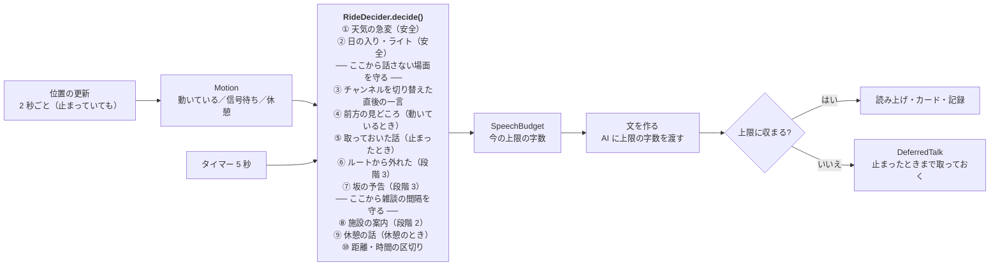

# CycleGuide の設計

| 項目 | 内容 |
|---|---|
| 対象 | CycleGuide（yorisoi-cycleguide）の構造と、platform・管理システムの変更 |
| 読む人 | アプリ開発者 |
| 状態 | 設計（承認済み・未実装） |
| 関連 | [要件定義](requirements.md)、[platform ADR-ECOSYSTEM-PLATFORM](https://github.com/duwenji/yorisoi-platform/blob/main/docs/decisions/ADR-ECOSYSTEM-PLATFORM.md)、[SanpoGuide の構造図](https://github.com/duwenji/yorisoi-sanpoguide/blob/main/docs/architecture.md) |

SanpoGuide と同じ作りを基本にします。DI ライブラリは使わず、`CycleApp.onCreate()` が共有部品を作り、画面と常駐のサービス（`RideService`）がそれを使います。散歩と違うのは、主に次の 4 つです。

1. **走り方**（`RideStyle`）が判定の値をまとめて持つ（要件 D-5）
2. **動いているかどうか**（`Motion`）で、話すかどうかと話の長さを変える（D-6）
3. **前方**を探し、着く前に話し終える（F-2）
4. **走行中は画面と操作を出さない**（S-1・S-2）

## 図 1 · 全体

```mermaid
flowchart LR
  subgraph UI["画面（ui）"]
    MainActivity
    MainScreen["MainScreen<br/>地図・発言カード・チャンネルの選択"]
    RidingScreen["RidingScreen<br/>「走行中」だけ"]
    SettingsScreen["SettingsScreen<br/>走り方・値の調整・AI"]
    HistoryScreen["HistoryScreen<br/>履歴・振り返り（段階 2）"]
  end

  subgraph RIDE["常駐処理（ride）"]
    RideService["RideService<br/>位置・判定・読み上げ・通知"]
    EarphoneNotice["EarphoneWatch・EarphoneRule<br/>イヤホンの注意"]
    MediaButtons["MediaButtons<br/>止める・もう一度（段階 3）"]
  end

  subgraph APP["共有部品（CycleApp.onCreate() で生成）"]
    style["style<br/>RideStyle・RideStyles・StyleValues"]
    companion["companion<br/>Motion・Ahead・QuietZones・SpeechBudget<br/>RideDecider・RideSession・DeferredTalk"]
    channel["kit-channel（platform に新設）<br/>Station・StationPrompts・StationRepository"]
    guide["kit-llm<br/>LlmClient・RelayClient・OperatorAi・OutputCheck・AiUsage"]
    geo["kit-geo<br/>SpotRepository・Overpass・天気・日の入り・地図<br/>前方の探し方・信号・自転車のルート"]
    voice["kit-voice<br/>Speaker"]
    history["history<br/>RideHistory（段階 2）"]
    diag["diagnostics<br/>開発者モードの記録"]
  end

  MainActivity --> RideService
  MainActivity -- "Motion を見て切り替える" --> MainScreen & RidingScreen
  RideService --> companion --> style
  companion --> geo & channel
  RideService --> guide & voice & history & diag
  RideService --> EarphoneNotice & MediaButtons
```

`RideService` が中心です。位置が来るたびと一定の間隔で `maybeTalk()` を呼び、そのときの状況（`RideSituation`）を集めて `RideDecider` に渡します。`RideDecider` は platform の `kit-companion` の `TalkEngine` に、ルールの並びを渡すだけです（ADR-ECOSYSTEM-PLATFORM E-7）。

## 図 2 · 走行中の判定



ゲート（`RideGate`）は 4 つです。

| ゲート | 開いている条件 | かかるルール |
|---|---|---|
| `NOT_QUIET` | 止まっている。または、動いていて、信号から 30 m より離れ、走り方の「話さない速さ」より遅い（F-5） | ③〜⑩ |
| `SPOT_GAP` | 前の見どころの話から、走り方の間隔 × チャンネルの頻度の倍率が過ぎた | ④ |
| `CHAT_GAP` | 前の話から、雑談の間隔が過ぎた | ⑧〜⑩ |
| `NOT_SWITCHED` | チャンネルを切り替えてから 1 分が過ぎた | ④〜⑩ |

①② は安全のルール（`safety = true`）で、どのゲートもかけません（S-4）。

## 主な部品の設計

### 走り方（`style`）

- 走り方（`RideStyle`）は、名前・見どころの選び方（`SpotScale`：小さな見どころも／大きな見どころだけ）・案内する施設（`Amenity`）と、判定の値（`StyleItem` ごとの既定値）を持ちます。値の一覧と範囲は `StyleItem` にあり、要件の「走り方のプリセット」の表の項目に、ひと言の間隔・距離の区切り・天気の予告の間隔・強い雨・日の入りを知らせる最後の時刻を足したものです

- `RideStyles.ALL` にプリセットを並べます。画面と判定はこの一覧だけを読むので、1 件足せばそのまま使えます（F-12・AC-15）
- アプリ利用者の調整は、SanpoGuide の `Thresholds` と同じ形（項目 → 値、範囲で丸める）の `StyleValues` で、走り方ごとに保存します。話せなくなる組み合わせ（日の入りの時刻の逆転、休憩が信号待ちより短い）は `conflicts()` で設定の画面に出します
- チャンネルの頻度（`talkLevel`：控えめ・ふつう・おしゃべり）は、間隔に掛ける倍率にします（×2・×1・×0.5）。頻度はエコシステムの語彙のまま、値はアプリが持ちます

### 動いているかどうか（`Motion`）

| 状態 | 条件 |
|---|---|
| `MOVING` | 直近の速度（3 点の中央値）が 0.8 m/s 以上。押して歩く速さ（5 km/h ≒ 1.4 m/s）は動いているに入る |
| `SIGNAL_STOP` | 0.8 m/s 未満が、走り方の「信号待ちとみなす長さ」（`SIGNAL_STOP_SEC`）以上続いた |
| `REST` | 0.8 m/s 未満が、走り方の「休憩とみなす長さ」（`REST_MIN`）以上続いた |

- 位置が 10 秒より長く来ない間（トンネルなど）は、状態を変えません。止まった長さも数えません。そのあとの止まった長さは、次に来た位置から数えます（AC-26）
- 精度の悪い位置（50 m より悪い）は使いません（SanpoGuide と同じ）

### 話の長さ（`SpeechBudget`）

- 上限の字数 = 走り方の秒数 × 1 秒あたりの字数（5 字）。1 秒あたりの字数は、開発者モードの記録（話した文の字数と、読み上げにかかった時間）で測ったもの。エミュレータで約 5 字だった
- 上限の字数は、プロンプトのスロット（`{{max_chars}}`）で AI に渡します
- 返事が上限を超えたら、読まずに `DeferredTalk` として取っておきます。取っておいた話は、次に止まったときに、そのときの上限に収まれば話します（信号待ちで収まらなければ、休憩まで待ちます）。見どころから 500 m 離れたもの、10 分たったものは捨てます（`DeferredTalk.prune`）

### 前方（`Ahead`）

- 進む向きは、`Location.bearing`（速度が 1 m/s 以上のとき）と、直近 30 m の移動の向きから決めます
- 前方の範囲は、向きの左右 45° の扇形で、走り方の「前方を探す距離」（`AHEAD_M`）までです
- 残りの時間 =（距離 − 50 m）÷ 速度 − 話の秒数 − 文を作る時間（5 秒）。残りの時間が 15 秒以下になったら話し始め、0 を切っていたら間に合わないので取っておきます（`Ahead.timing`。`RideDecision.Defer`）
- スポットの取得は、現在地ではなく前方の点（現在地から向きに「前方を探す距離」の半分進んだ点）を中心に行います（kit-geo の `SpotRepository` の `searchCenter`）。中心が 300 m 動いたら取り直します

### 話さない場面（`QuietZones`）

- 信号の位置（OSM の `highway=traffic_signals`）を、スポットと一緒に Overpass で取ります
- 動いているときに、信号から 30 m 以内に入るか、走り方の「話さない速さ」以上になったら、`NOT_QUIET` を閉じます。止まっているとき（信号待ちを含む）は閉じません

### 画面と通知（S-1・S-2・S-3）

- `MainActivity` は `Motion` を見て、`MOVING` のときは `RidingScreen`（「走行中」とだけ出す暗い画面）にします。`FLAG_KEEP_SCREEN_ON` は付けません
- 常駐の通知は、`MOVING` の間は操作のボタンを外した形に差し替えます
- `EarphoneWatch` は `AudioDeviceCallback` でイヤホン（Bluetooth・有線・USB）を見つけます。つながっていれば、止まっているときに走行ごとに一度、注意を読み上げます（`EarphoneRule`）。初めて走り始める前の注意は、開始の画面のダイアログで出します

### 段階 3 の部品

| 部品 | 設計 |
|---|---|
| 自転車のルート（F-15） | kit-geo の `RouteClient` に自転車のプロファイル（FOSSGIS OSRM の自転車）を足す |
| ルートに沿った取得（F-16） | ルートを 1 km ごとに区切り、Overpass の `around`（線に沿った範囲）で前もって取る |
| ルートから外れた（F-17） | ルートの線からの距離が 50 m を超える状態が 10 秒続いたら、一度だけ話す |
| 坂の予告（F-8） | 標高の取り先は U-2 で決める（候補: Open-Meteo の Elevation API。天気と同じサービス） |
| メディアボタン（F-21） | `RideService` に `MediaSession` を持たせ、再生・一時停止で「止める」「もう一度」を切り替える |

## モジュールとパッケージ

| モジュール | 中身 |
|---|---|
| `:app` | 画面・常駐・判定・走り方・記録 |
| `:prompts`（JVM） | CycleGuide のプロンプト・パック（`io.github.duwenji.yorisoi.cycleguide:prompts`）。プロンプトの枠、組み込みのチャンネル、審査の見本（F-30） |

`:app` のパッケージ（`io.github.duwenji.yorisoi.cycleguide.`）:

| パッケージ | 役割 | 主なファイル |
|---|---|---|
| `ui` | 画面と ViewModel | MainScreen, RidingScreen, SettingsScreen, HistoryScreen |
| `ride` | 常駐のサービス、イヤホンの注意、メディアボタン | RideService, EarphoneWatch, EarphoneRule, MediaButtons |
| `companion` | 判定とその材料、定型の話（AI で文を作るまでの話と、安全の案内の文） | RideDecider, RideSession, Motion, Ahead, QuietZones, SpeechBudget, DeferredTalk, Lines |
| `style` | 走り方と調整 | RideStyle, RideStyles, StyleValues |
| `settings` | 設定の保存（走り方・走り方ごとの値の変更・チャンネル・イヤホンの注意を出したか） | SettingsRepository |
| `history` | 走行の履歴（段階 2） | RideHistory |
| `diagnostics` | 開発者モードの記録の書き出し（記録そのものは platform kit-companion の `SessionRecorder`。走行の開始・位置・状態・判定・話・読み上げの時間・AI・天気・スポットの検索） | RideExport |
| (root) | 共有部品の生成、通知チャンネルの登録 | CycleApp |

## platform に移すもの（要件 D-4）

SanpoGuide のアプリ側にあるコードを、CycleGuide で使う段階の前に platform に移します。移したあと SanpoGuide もそれを使うように直し、SanpoGuide のテストとエミュレータの散策で確かめます（R-3）。

| 段階 | 移すもの（SanpoGuide のいまの場所） | 移す先 | 直す抽象 |
|---|---|---|---|
| 1 | `guide/OperatorAi`・`guide/OutputCheck`・`settings/AiUsage` | `kit-llm` | `OperatorAi` が読む `BuildConfig`（中継の URL・Play Integrity）を引数にする |
| 1 | `station/Station`・`StationRepository`、`material/ChannelMaterials`、`:prompts` の `BuiltInChannels` の読み込み | `kit-channel`（新設。`Station`・`StationRepository`・`ResourceChannels`・`ChannelMaterials`） | `Station` が持つ頻度を、コアの段階（`TalkLevel`）だけにする。間隔などの値はアプリが持つ。`StationRepository` は設定（`GuideSettings`）ではなく `ChannelChoice` を受け取り、記録（`WalkRecord`）ではなくチャンネルの key の並びから名前を作る。スロットからプロンプトの変数を作るところ（`StationPrompts`）、表示名（`StationLabels`）、費用の目安（`AiCost`）は、アプリの文面と値によるのでアプリに残す |
| 1 | `diagnostics/WalkDiagnostics` | `kit-companion`（`SessionRecorder`） | 散歩の名前を外し、開始と終了の種類の名前を引数にする（SanpoGuide は `walk_start`・`walk_end` のまま） |
| 2 | `station/remote`（`ChannelSync`・`ChannelStore`・`ThirdPartyChannels`・`TinkEd25519`）、`report/Report` | `kit-channel` | `ChannelSync` が読む `SanpoProfile` を `AppProfile` の引数にする |
| 2 | `material`（`Producer`・`Cues`・`Selectors`・`MaterialPlan`・`Grounding`・`ResourceProducer`） | `kit-channel` | `Producer` が読む `TalkEvent`・`WalkSession` を、汎用の文脈（`MaterialContext`、ADR-ECOSYSTEM-PLATFORM E-16）にする |

`kit-channel` の新設は、E-4（「素材提供者の実装とチャンネルの取り込み・画面は、2 本目のアプリで共通の形が分かるまでアプリに置く」）の見直しにあたります。段階 1 の移し替えの前に、platform の ADR に足します。

## platform・管理システムのそのほかの変更

| 段階 | 先 | 変更 |
|---|---|---|
| 1 | kit-geo | 天気の急変の判定（`WeatherChangeDetector`。SanpoGuide から移し、先読みの時間と強い雨の量を引数にする） |
| 1 | kit-geo | 前方を中心にした取得（`SpotRepository` に取得の中心を渡せるようにする。渡さなければ今と同じ）、信号の位置の取得（任意。SanpoGuide は使わない） |
| 1 | core-format | `cycleguide` を含む版を公開する（PR #29 は版を上げていない） |
| 1 | yorisoi-console | アプリの一覧（`ecosystem.ts`）・中継の受け付けるパッケージ（`relay-config.ts`）・段階の版（`appStageVersions`）に CycleGuide を足す（要件 X-5） |
| 2 | yorisoi-console | `cycle` の見本を、CycleGuide のプロンプト・パックで作る（X-6） |
| 3 | kit-geo | 自転車のルート、線に沿った取得、標高 |

## 段階 1 の実装の順番

1. platform: ADR に `kit-channel` を足す。kit-llm・kit-channel への移し替え、kit-geo の前方の取得と信号。SanpoGuide を新しい版に上げて確かめる
2. CycleGuide: リポジトリの骨組み（Gradle・`:app`・`:prompts`・CI）
3. 走り方・`Motion`・`SpeechBudget`・`Ahead`・`QuietZones`・`RideDecider`（判定は Android に依存しない形にし、場面のテストを書く）
4. `RideService`・画面・イヤホンの注意
5. プロンプト・パックと組み込みのチャンネル（U-4 を決める）
6. 開発者モードの記録、エミュレータでの受入条件の確認
7. 管理システムの変更（X-5）

## 未決事項

| ID | 内容 | 決める時期 |
|---|---|---|
| A-3 | 速度の閾値（0.8 m/s）と中央値を取る点の数 | エミュレータと実機で走ってから |
