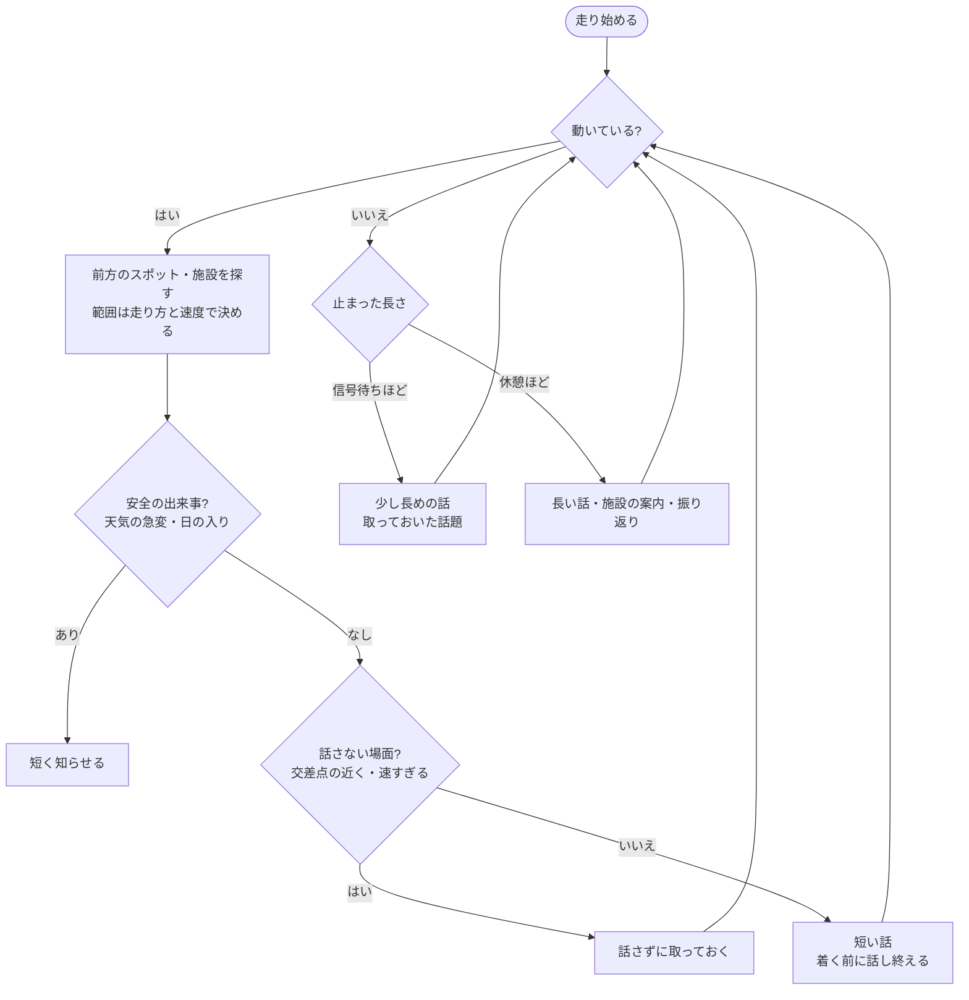
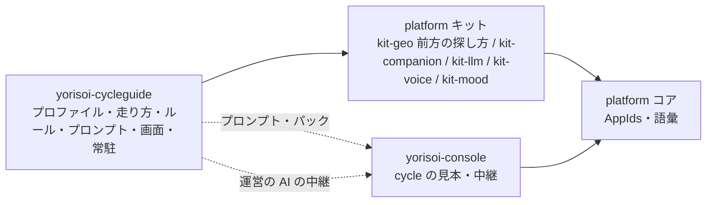

# requirements-refinement 記録: CycleGuide

## 基本情報
| 項目 | 内容 |
|------|------|
| テーマ | yorisoi の 2 本目のアプリ CycleGuide（サイクリングの伴走）の要件 |
| 記録日 | 2026-10-24 |
| 承認者 | 開発者（duwenji） |
| 実行モード | balance |

## 段階1〜3: 準備・詳細化・開発者の入力

### 背景
- platform ADR-ECOSYSTEM-PLATFORM E-23 で、2 本目のアプリをサイクリングの伴走（`cycle`）に決めている。E-26 で `cycle` の代表アプリにもなる
- E-20「共通部分は 2 本目のアプリを作りながら直す」に従い、散歩だけに合わせた抽象をこのアプリで見直す
- コアには `Activity.CYCLE` がある（core-format `Ecosystem.kt`）。`AppIds` は `sanpoguide` だけ

### 開発者の入力（2026-10-24）
- 想定する人: 既定は街中をゆっくり走る人（ポタリング）。**設定で切り替えられる**ようにする
- 進め方: T-2（このアプリ）を T-1（雛形と生成のスキル）より先に行う
- リポジトリ名は `yorisoi-cycleguide`。`applicationId` もこれに合わせる → `io.github.duwenji.yorisoi.cycleguide`

### 期待成果
- 走っている人に、周りの見どころや安全の情報を声で届ける。画面を見なくても使える
- `cycle` のチャンネルが実際に動き、管理システムで見本を作れる（E-26）
- 散歩向けだった platform の抽象（距離・間隔・判定）が、速さの違う過ごし方でも使えると確かめられる

### スコープ（Phase 1 時点の案）
- Android アプリ（SanpoGuide と同じ技術: Kotlin・Compose・yorisoi-platform のキット）
- 走行中の声の案内（前方の見どころ・止まったときの話・安全の案内・施設の案内）
- 走り方の設定（ポタリングを既定とし、ほかの走り方に切り替えられる）
- エコシステムのチャンネル・素材集の利用、AI の接続（自分のキー・運営の AI の中継）
- platform 側の手直し（`AppIds` の追加、kit-geo の前方の探し方など）

### 非スコープ（Phase 1 時点の案）
- iOS
- ナビゲーション（曲がる方向の案内）。ルートを引くことはしても、道案内アプリの代わりにはしない
- 速度・心拍・ケイデンスなどのトレーニング機能、外部センサー
- 走行記録の共有・SNS 連携
- T-1（雛形と生成のスキル）

### 非機能要件（候補）
- 安全・法令: 走行中は画面を出さず、操作も求めない。既定はスピーカーで流し、背景音を使わない（E-23）
- 電池: 2〜3 時間のポタリングで、端末の電池が尽きない（数値は段階8で決める）
- 通信: 走る速さでもスポットの取得が間に合う（前もって取る）
- プライバシー: 位置の扱いは SanpoGuide と同じ（ProducerPolicy、E-16）

### 主要ドメイン概念
- エンティティ候補: 走行（ライド）、走り方（プロファイルのプリセット）、前方のスポット、停止（信号待ち・休憩）、施設、チャンネル、素材集、走行の記録
- 関係候補: 走行は 1 つの走り方とチャンネルで行う／走り方が判定の値（範囲・間隔・話の長さ）を決める／停止の種類で話の長さが変わる

## 段階4: 曖昧点・依存関係

### 曖昧点
| ID | 曖昧点 | 扱い |
|---|---|---|
| A-1 | 走り方を何種類にするか、何を変えるか | 案ごとに決める（段階6） |
| A-2 | SanpoGuide のアプリ側にあるコード（チャンネルの取り込み・運営の AI・素材提供者・設定）を写すか、platform に移すか | 段階7で決める（E-4 は「2 本目で共通の形が分かるまでアプリに置く」） |
| A-3 | 画面でのアプリ利用者の呼び方（SanpoGuide の「散策者」にあたるもの） | 案「サイクリスト」。段階8で決める |
| A-4 | 走行中に操作が要るとき（話を止める・もう一度聞く）の手段 | 最小版は「止まってから画面で」。物理ボタン・音声は将来 |
| A-5 | 「止まっている」をどう見分けるか（信号待ちと休憩、押して歩いているとき） | 速度と時間で分ける。値は走り方ごと |
| A-6 | 交差点・下り坂では話さない、をどこまでやるか | 最小版は速度と OSM の信号の位置で抑える。坂は将来 |

### 依存関係
| ID | 依存先 | 内容 |
|---|---|---|
| D-1 | platform core-format | `AppIds` に `cycleguide` を足す（マイナー版） |
| D-2 | platform kit-geo | 進行方向の前方を探す、走る速さに合わせて前もって取る |
| D-3 | platform kit-companion | ルールの並びはそのまま使える見込み。動いているか止まっているかでの話の長さの上限は、アプリ側で持てるか確かめる |
| D-4 | yorisoi-console | `cycle` の見本（E-26）、プロンプト・パックの受け入れ、運営の AI の中継にアプリを足す |
| D-5 | 法令 | 2024-11 施行の道交法改正（ながらスマホ）、2026-04 の自転車の反則金、都道府県のイヤホンの規則。公開前に最新の内容を確かめる |
| D-6 | Google Play | 新しいアプリの登録、データ セーフティ、位置情報の常時利用の申告 |
| D-7 | platform ADR-ECOSYSTEM-PLATFORM | T-1・T-2 の時期を入れ替える |

### 矛盾・不足
- ADR の T-2 は「T-1 の後」。開発者の決定（T-2 を先）と食い違うので、ADR の追従タスクの時期を書き直す（D-7）
- SanpoGuide の判定の値（スポット 60m・休憩 30m 以内 2〜4 分など）はアプリ側の定数なので、そのままでは使えない（走り方ごとに持つ）

## 段階5: 論点フロー

影響する範囲:

## 段階6: 要件整理案

| 観点 | 案1: スコープ最小 | 案2: 標準（推奨） | 案3: 将来拡張 |
|---|---|---|---|
| 走り方 | ポタリングだけ。値を設定で上書き | **ポタリング（既定）・ロングライド**の 2 つのプリセットと、値の個別の調整 | 案2 ＋ 通勤など、プリセットを足せる形 |
| 声の案内 | 前方の見どころ、止まったときの話、天気の急変・日の入り | 案1 ＋ 施設の案内（トイレ・水分・駐輪場・空気入れ・自転車店・コンビニ） | 案2 ＋ 坂の予告 |
| チャンネル | 組み込みのチャンネル 1〜2 本 | 組み込み 2〜3 本 ＋ エコシステムのリストから取得・絞り込み | 案2 と同じ |
| AI | 自分のキー・運営の AI の中継 | 案1 と同じ | 案1 と同じ |
| 記録 | 走行の記録（距離・時間・経路） | 案1 ＋ 履歴と振り返り、開発者モードの詳しい記録 | 案2 ＋ ルートの計画、外れたことの検知 |
| `cycle` の代表 | しない（見本は後） | **する**（プロンプト・パックを公開） | する |
| 操作 | 止まってから画面で | 案1 と同じ | 物理ボタン・音声での操作 |
| platform の手直し | `AppIds`・kit-geo の前方 | 案1 ＋ チャンネルの取り込みなどの共通化（A-2 の決め方による） | 案2 ＋ 標高・ルートに沿った取得 |
| 評価 | 早く走らせられるが、E-26 の代表と E-20 の確かめが足りない | ADR の T-2 の目的（抽象を直す・代表になる）を満たし、量も現実的 | 範囲が広く、抽象を直す前に機能が膨らむ |

## 段階7: 要件案の決定（ゲート #1）
- 実施内容: 段階6の 3 案と A-2 を開発者に示した
- 決定（2026-10-24）: **案3（将来拡張）**。A-2 は**必要になったものから platform に移し、SanpoGuide もそれを使う**
- 判断根拠: 開発者の選択。範囲が広いので、仕様では機能を公開の段階（1〜3）に分けて抑える（R-4）
- 承認ステータス: 承認済み

## 段階8: 仕様化
- 実施内容: [requirements.md](../requirements.md) に、方針（D-1〜D-6）・走り方のプリセットの値の案・機能要件（F-1〜F-30、段階つき）・非機能要件（S・N・P）・受入条件（AC-1〜AC-12）・未決事項（U-1〜U-5）・リスク（R-1〜R-4）を書いた
- A-1 → D-5・プリセットの表。A-3 → U-1。A-4 → F-21（メディアボタン）、ウェイクワードは非スコープ。A-5 → F-3。A-6 → F-5・F-8
- 承認ステータス: 段階9で承認

## 段階9: 仕様のレビュー
- 決定（2026-10-24）: 開発者が仕様を承認
- 承認ステータス: 承認済み

## 段階10: 検証の観点
- 実施内容: 受入条件と要件を突き合わせ、受入条件のなかった要件（F-1・F-7・F-8・F-12・F-15・F-16・F-20・F-25・F-27〜F-30・S-2・S-5・N-1・N-3・P-1・P-2）に AC-13〜AC-29 を足した。異常系の AC-20（AI が答えない）・AC-25（通信が切れる）・AC-26（GPS が途切れる）も入れた

| 観点 | 確かめること | 受入条件 | 確かめ方 |
|---|---|---|---|
| 機能：前方の見どころ | 着く前に話し終える、上限の長さ、取っておいて止まったときに話す | AC-1・AC-3・AC-24 | エミュレータの経路・開発者モードの記録 |
| 機能：止まったかどうか | 信号待ち・休憩・押して歩くことの見分け | AC-2・AC-26 | 判定の単体テスト・エミュレータ |
| 機能：話さない場面 | 交差点の手前・速すぎるとき | AC-4 | 判定の単体テスト・エミュレータ |
| 機能：安全の案内 | 天気・日の入り・止められないこと | AC-5 | 判定の単体テスト・エミュレータ |
| 機能：走り方 | 既定・切り替え・値の調整・プリセットの追加・施設の種類 | AC-6・AC-14・AC-15 | 単体テスト・エミュレータ |
| 機能：ルート・坂 | ルートを引く・前もって取る・外れたことを知らせる・坂の予告 | AC-11・AC-16・AC-17 | エミュレータ |
| 機能：チャンネル・AI | 組み込み・リストの絞り込み・2 つの AI の経路 | AC-9・AC-19・AC-20 | エミュレータ・管理システム（開発用） |
| 機能：記録 | 履歴・振り返り・書き出し | AC-21・AC-22 | エミュレータ |
| 機能：エコシステム | `cycle` の見本 | AC-23 | 管理システム（開発用） |
| 非機能：安全・法令 | 画面を出さない・操作を求めない・スピーカー・法令の確認 | AC-7・AC-8・AC-18・AC-29 | エミュレータ・実機・公開の手順 |
| 非機能：電池・通信 | 電池の消費・通信が切れたとき | AC-12・AC-25 | 実機・エミュレータ |
| 非機能：プライバシー | 送り先・キーの保存 | AC-27・AC-28 | 通信の記録・端末のファイル |
| 操作 | メディアボタン | AC-10 | 実機 |
| 異常系 | AI が答えない・通信が切れる・GPS が途切れる・画面を消す | AC-13・AC-20・AC-25・AC-26 | エミュレータ |
| 異常系（受入条件の外） | 通話が始まったとき（オーディオフォーカス）、権限を断られたとき、電池の節約で常駐が止められたとき | なし | 設計で決めてテストに入れる（kit-voice のオーディオフォーカスは SanpoGuide と同じ） |
| 回帰 | platform に移したコード（D-4）で SanpoGuide が変わらない。`AppIds` を足したあとも管理システムと SanpoGuide が動く | なし（R-3） | SanpoGuide のテスト・エミュレータの散策・管理システムのテスト |

## 段階11: 観点のレビュー（ゲート #2）
- 決定（2026-10-24）: 開発者が観点を承認
- 承認ステータス: 承認済み

## 段階12: 整合性と未確定事項の確認

### 矛盾の確認
| 対象 | 見つかったこと | 直したこと |
|---|---|---|
| AC-1 と F-5 | 見どころが信号の近くにあると、F-5 で話せず AC-1 を満たせない | AC-1 を、信号から 30 m 以上離れた見どころに限った |
| AC-8 と S-3 | kit-voice の Speaker は Bluetooth のイヤホンがつながるとそちらで鳴る（Android の決まり）。「スピーカーから出る」はイヤホンがないときだけ成り立つ | S-3 を「イヤホンを前提にしない」と書き直し、AC-8 をイヤホンなしの端末に限って、イヤホンのときの注意を足した |
| F-17 と AC-11 | 外れたとみなす距離（50 m）が受入条件にしかない | F-17 に 50 m を書いた |
| F-4 | 話の長さを秒で決めているが、話す前に秒は分からない | 読み上げの速さから字数に直して確かめる、と書いた |
| プリセットの表と AC-5・AC-14 | 値（日の入り 30 分前、施設の種類）は一致 | なし |

### 依存先の確認事項
- kit-geo の RouteClient は FOSSGIS の OSRM の歩きのプロファイルだけ → U-3 を更新、X-2
- yorisoi-console は、アプリの一覧（ecosystem.ts）・中継の受け付けるパッケージ（relay-config.ts）・段階の版（appStageVersions）・見本のプロンプト（MachineReview.kt が SanpoGuide のプロンプトを読む）が SanpoGuide だけ → X-5・X-6
- Google Play の新しいアプリの製品版の前のクローズド テスト → R-5
- まとめて requirements.md の「依存先」（X-1〜X-6）に書いた

### 着手できるか
- 段階 1 は着手できる。前もって要るのは X-1（`AppIds`）と X-3（ADR の時期）。X-5 は段階 1 の公開の前まででよい
- 段階 3 は U-2（標高）・U-3（自転車のルート）を決めてから

## 段階13: 要件確定のレビュー（ゲート #3）
- 開発者の指摘（2026-10-24）: S-3・AC-8 は注意喚起のレベルにする
- 対応: S-3 を「音の出先は端末に任せ、注意を促す」に、AC-8 を「注意が出る」に書き直した。D-7 を足し、ADR E-23 の書き直しを X-3 に入れた
- 決定（2026-10-24）: 開発者が要件を確定として承認
- 承認ステータス: 承認済み

## 段階14: 報告

### 確定した要件
- [requirements.md](../requirements.md)（REQ-CYCLEGUIDE、承認済）
- 方針: D-1〜D-7（名前・T-2 を先に・範囲は案3 を段階 1〜3 で・コードは必要なものから platform へ・走り方のプリセット・話の長さの 3 つの状態・イヤホンは注意を促すまで）
- 機能要件: F-1〜F-30（段階 1・2・3）
- 非機能要件: 安全・法令 S-1〜S-5、性能・電池・通信 N-1〜N-3、プライバシー P-1・P-2
- 受入条件: AC-1〜AC-29

### スコープ外
- iOS、交差点ごとの曲がる案内、トレーニング機能と外部センサー、共有・SNS、ウェイクワードの音声操作、T-1

### 保留事項
- U-1 画面での呼び方（案「サイクリスト」）、U-2 標高データ、U-3 自転車のルート、U-4 組み込みのチャンネルの中身、U-5 中継の上限をアプリごとに分けるか

### リスク
- R-1 信号のない交差点、R-2 GPS の速度のぶれ、R-3 platform への移し替えでの SanpoGuide の回帰、R-4 範囲の広さ、R-5 Google Play のクローズド テスト

### 次の設計への入力
1. platform: ADR-ECOSYSTEM-PLATFORM の T-1・T-2 の時期と E-23 のスピーカーの扱いを直す（X-3）。`AppIds` に `cycleguide`（X-1）
2. 設計: アーキテクチャ（SanpoGuide の architecture.md にならう）。走り方のプリセットのデータの形、停止の判定、話の長さの字数への換算、前方の探し方（kit-geo、X-2）
3. 段階 1 の前に決める: U-4（組み込みのチャンネル）、U-1（呼び方）
4. yorisoi-console: アプリの一覧・中継・段階の版（X-5）は段階 1 の公開の前
